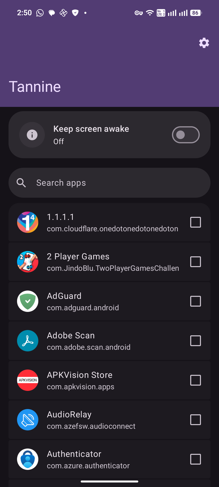
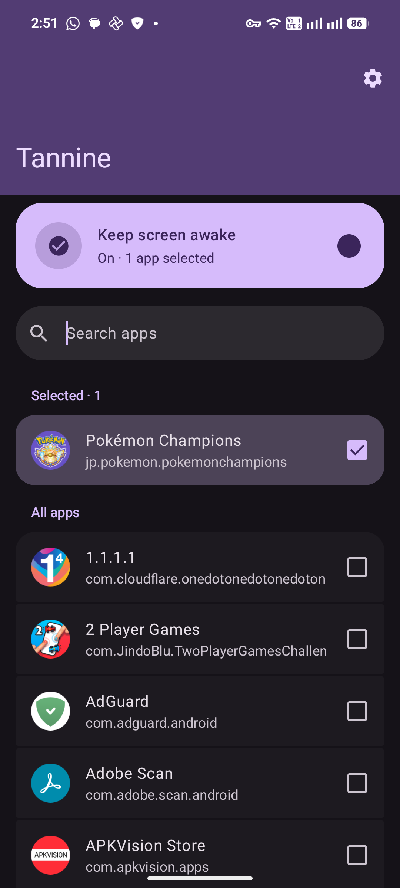
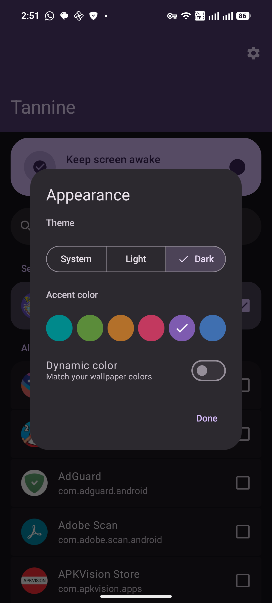

<div align="center">

# Tannine

### Keep your screen awake where it matters.

An Android app that keeps the screen on for the apps you choose—not for your entire device.

<p>
  <a href="#features">Features</a>
  &nbsp;&bull;&nbsp;
  <a href="#getting-started">Getting started</a>
  &nbsp;&bull;&nbsp;
  <a href="#roadmap">Roadmap</a>
</p>


</div>

<br>

## The idea

Apps such as recipes, navigation, reading, and monitoring tools are much more useful when the display does not turn off halfway through a task. Android's system-wide screen-timeout setting solves that problem, but it also affects every app on the phone.

Tannine takes a more selective approach. Register the apps that need an always-on screen, and Tannine keeps the display awake only while one of those apps is in the foreground.

The idea was inspired by [Kaffeine](https://play.google.com/store/apps/details?id=com.neilsayok.caffeine&hl=en&pli=1). Kaffeine provides a simple device-wide toggle; Tannine is being built for app-specific control.

## See it in action

> Screenshots will be added as the UI is finalized.

<div align="center">

| Choose your apps | Keep the screen awake | Customize appearance |
|:---:|:---:|:---:|
|  |  |  |

</div>

## Features

<table>
<tr>
<td width="50%" valign="top">

### App-specific control

Choose exactly which apps are allowed to keep the screen awake. Other apps continue to use the normal device screen timeout.

</td>
<td width="50%" valign="top">

### Foreground detection

Tannine watches which app is currently in use and activates the screen-awake behavior only for registered apps.

</td>
</tr>
<tr>
<td width="50%" valign="top">

### Timeout restoration

When you leave a registered app, Tannine restores the screen-timeout setting that was active before.

</td>
<td width="50%" valign="top">

### Built for Android

Uses Android's usage-access and system-settings APIs, with a foreground service for reliable monitoring.

</td>
</tr>
</table>

## How it works

1. Register the apps you want Tannine to manage.
2. Grant usage access and permission to modify system settings.
3. Start Tannine.
4. Open a registered app—the screen stays awake while it is in the foreground.
5. Leave the app—Tannine returns control to your normal screen timeout.

Tannine does not read the content of other apps. It only uses foreground-app information to decide when the screen-awake behavior should be active.

## Getting started

### Requirements

- Android 7.0 (API 24) or newer
- Android Studio
- JDK 17

### Build and run

```powershell
git clone https://github.com/<your-username>/Tannine.git
cd Tannine
.\gradlew.bat assembleDebug
```

The debug APK will be available at:

```text
app/build/outputs/apk/debug/app-debug.apk
```

You can also open the project in Android Studio and run the `app` configuration on a connected device or emulator.

### Permissions

Tannine asks for the following Android capabilities:

| Permission | Why it is needed |
|---|---|
| Usage access | Identify which app is currently in the foreground |
| Modify system settings | Change and restore the screen timeout |
| Notifications | Show the foreground-service notification |
| Run at startup | Restore the watcher after a device reboot |

Permission names and setup screens may vary by Android version and device manufacturer.

## Roadmap

Tannine is intentionally starting small. These are the next planned improvements:

- [ ] Add a device-wide keep-screen-awake toggle
- [ ] Start Tannine automatically when a registered app is opened
- [ ] Add a Quick Settings tile
- [ ] Improve onboarding and permission guidance
- [ ] Add polished UI screenshots and automated tests

Have an idea or a use case that would make Tannine more useful? Open an issue and describe it.

## Project structure

```text
app/src/main/java/com/shidroid/tannine/
├── MainActivity.kt             # Compose UI and app registration
├── WatcherService.kt           # Foreground monitoring service
├── ForegroundAppDetector.kt   # Current foreground-app detection
├── TimeoutController.kt        # Screen-timeout management
└── BootReceiver.kt             # Startup handling
```

## Contributing

Contributions are welcome. For changes involving foreground detection or screen-timeout behavior, test on a physical Android device when possible.

1. Create a focused branch.
2. Make your change and include UI screenshots when relevant.
3. Verify the app builds:

   ```powershell
   .\gradlew.bat assembleDebug
   ```

4. Open a pull request with a short explanation of the behavior change.

## License

Tannine is available under the [MIT License](LICENSE).

<div align="center">
<br>

Made for the apps that should stay open.

</div>
